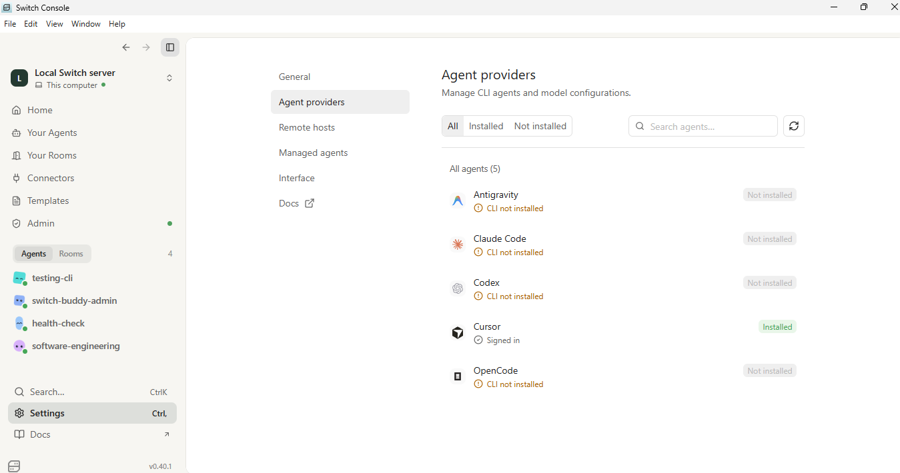
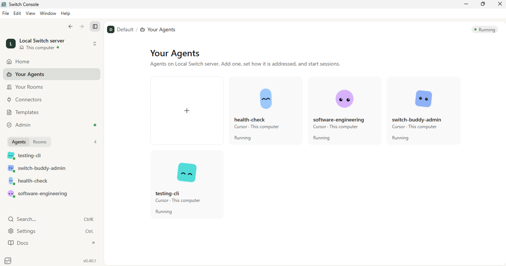

# DevPilot AI 🚀
### Multi-Agent AI Development & API Monitoring using Switch Console, Cursor & Slack

**Your AI-powered development workspace, accessible through Slack.**

## 🎥 Project Demo

[](https://youtu.be/vkqpB1x2XsE)

▶️ **[Watch the Full Project Demonstration on YouTube](https://youtu.be/vkqpB1x2XsE)**

## 🚀 Overview

DevPilot AI is a multi-agent AI workspace built entirely using **Switch Console**, integrated with **Cursor Agents** and **Slack**.

The idea is simple: what if developers could manage development tasks, resolve bugs, and monitor application APIs just by chatting with AI agents through Slack?

Using Switch Console as the central agent management platform, I created specialized AI agents that interact with local development environments and perform different engineering tasks.

Instead of manually opening development tools for every task, I can communicate with these agents through dedicated Slack channels.

The project currently focuses on two major use cases:

- **Software Engineering Agent:** Assists with software development, feature implementation, and bug fixing in connected local repositories.
- **Health Check Agent:** Executes application API health checks and reports endpoint availability, HTTP status codes, and response times.

## 🏗️ Architecture

The system connects three main components:

| Component | Responsibility |
|---|---|
| Switch Console | Central platform for managing and orchestrating AI agents |
| Cursor Agents | AI-powered development and interaction with local repositories |
| Slack | Conversational interface for communicating with agents and assigning tasks |

### System Workflow

```text
              Slack Workspace
                    |
             Dedicated Channels
                    |
              Switch Console
                    |
             Cursor Integration
                    |
             Specialized Agents
                /         \
               /           \
       Health Check     Software
          Agent        Engineering Agent
            |                 |
       Local Project     Local Repository
            |                 |
       API Monitoring    Code Development
            |                 |
       Health Reports    Code Changes
            |                 |
            +------ Slack ----+
```

## 🤖 AI Agents

### 1. Software Engineering Agent 💻

The Software Engineering Agent acts as an AI-powered development assistant connected to my local development repository.

It allows me to communicate development requirements through Slack and get assistance with actual code changes.

**Capabilities and use cases:**

- Implementing new features.
- Resolving bugs reported by clients.
- Modifying existing application logic.
- Working with connected local code repositories.
- Assisting with development tasks remotely through Slack.

**How it works:**

1. Create a dedicated Slack channel for development.
2. Invite the Software Engineering Agent.
3. Connect the required local repository through Switch Console.
4. Send development instructions through Slack.
5. The agent works with the connected codebase and makes the requested changes.

I have already used this workflow to implement features and resolve bugs in my local development repositories.

### 2. Health Check Agent ❤️

The Health Check Agent is designed to monitor application APIs and provide health-check reports directly through Slack.

It is connected to a local application project containing the relevant API health-check logic.

**Information provided:**

- API endpoint availability.
- HTTP response status codes.
- API response times.
- Endpoint-level health status.
- Consolidated health-check results.

**How it works:**

1. Create a dedicated Slack channel for health monitoring.
2. Invite the Health Check Agent.
3. Connect the relevant local project directory.
4. Request an application health check through Slack.
5. The agent executes the configured health-check workflow and returns the results.

This makes it easier to check multiple application APIs without manually testing every endpoint.

## 💬 Slack Integration

Slack is the primary communication interface for interacting with the AI agents.

I created separate channels for different engineering responsibilities.

| Slack Channel | Purpose | Assigned Agent |
|---|---|---|
| Health Check | Application API monitoring | Health Check Agent |
| UAT Development | Software development and bug fixing | Software Engineering Agent |

Each channel is configured with its respective agent and connected development environment.

This separation helps keep different workflows organized and makes it easier to delegate tasks.

## 📸 Screenshots

### 1. Agent Provider Configuration



### 2. Switch Agent Configuration



## 🛠️ Technology Stack

- **Switch Console:** Agent configuration, management, and orchestration.
- **Cursor Agents:** AI-powered software development capabilities.
- **Slack:** Messaging interface and communication with specialized agents.
- **Local Development Environment:** Provides access to application repositories and development resources.

## ⚙️ Setup & Configuration

The project is configured entirely through Switch Console.

### Prerequisites

- Switch Console installed and running locally.
- Cursor installed and authenticated.
- Slack workspace with the required permissions.
- Slack integration configured with Switch Console.
- Local development repositories accessible to the agent environment.

### Configuration Steps

1. Install and launch Switch Console locally.
2. Connect Switch Console with Cursor Agents.
3. Authenticate Cursor.
4. Create the required specialized agents:
   - Software Engineering Agent
   - Health Check Agent
5. Configure the instructions and responsibilities for each agent.
6. Connect your Slack workspace.
7. Create dedicated Slack channels for the agents.
8. Invite the corresponding agents into their channels.
9. Assign the required local project directories to the respective rooms.
10. Start interacting with your agents directly through Slack.

**Important:** Since the agents interact with local repositories, the machine hosting Switch Console and the required integrations must remain running and have access to the connected project directories.

## 🎯 Real-World Problem & Impact

As a software developer, my responsibilities include:

- Developing and maintaining enterprise applications.
- Implementing client-specific requirements.
- Resolving UAT and production-related bugs.
- Deploying applications to servers.
- Monitoring application APIs and services.

These activities often require switching between development environments, terminals, monitoring tools, and communication platforms.

I wanted to explore how specialized AI agents could simplify these workflows.

With this project, I can:

- Delegate development tasks through Slack.
- Get assistance with bug fixes and feature implementation.
- Execute API health checks through a dedicated agent.
- Interact with my development environment even when I am away from my workstation, provided the local environment remains accessible.

The goal is to make AI agents practical assistants in everyday software engineering workflows.

## 🔮 Future Scope

There are several possibilities for expanding this system:

- **DevOps Agent:** Assist with server operations and deployment workflows.
- **Log Analysis Agent:** Analyze application logs and help identify errors.
- **Monitoring Agent:** Extend application and server monitoring.
- **Testing Agent:** Assist with automated testing and test-case generation.
- **Multi-Agent Collaboration:** Allow specialized agents to collaborate on complex engineering tasks.
- **Deployment Automation:** Extend development workflows toward controlled deployment processes.

## 🏆 Hackathon Project

Built for the **WeMakeDevs Hackathon**.

This project explores how AI agent orchestration can transform everyday software engineering workflows through conversational interfaces.

## 👨‍💻 Author

**Swaraj Pal**

Software Developer | AI & Agentic Workflow Enthusiast

**Built with:** Switch Console × Cursor Agents × Slack

---

⭐ If you find this project interesting, feel free to explore the demonstration and share your feedback.

**The vision: Make your development team accessible through a conversation.**